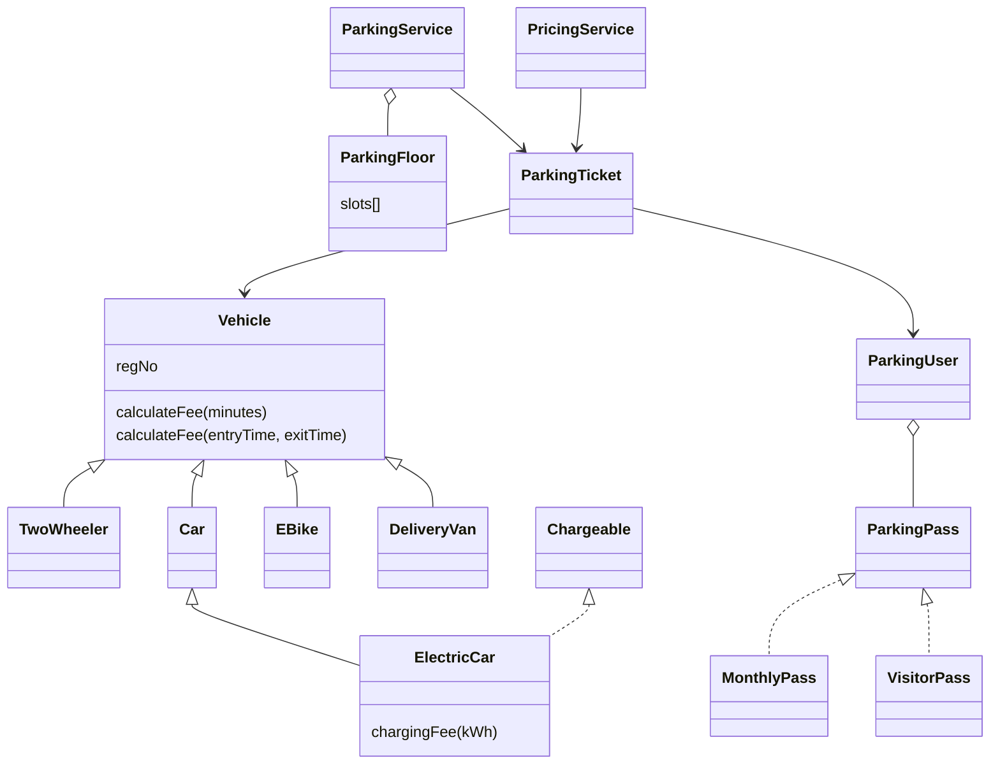
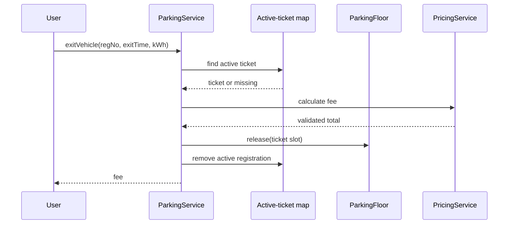

# Implementation and Design Report

## 1. Problem model and objects (Task 1)

**Inputs:** registration and vehicle category at entry; user identity/role and pass; entry and exit timestamps; measured EV charging kWh at exit.
**Outputs:** unique ticket, floor/slot location, fee and explicit exceptions for invalid operations.

| Candidate | Responsibility / decision |
| --- | --- |
| `Vehicle` | Abstract identity and common hourly fee behavior; canonical uppercase registration; equality/hash code by registration. |
| `TwoWheeler`, `Car`, `ElectricCar`, `EBike`, `DeliveryVan` | Vehicle-specific tariffs/capabilities. |
| `ParkingUser`, `UserRole`, `MonthlyPass`, `VisitorPass`, `ParkingPass` | User role and date-bounded pass. Monthly pass applies only to student/staff; visitor pass validates one-day access. |
| `ParkingFloor` | Owns a floor's slot array and validates occupy/release. |
| `ParkingTicket` | Immutable vehicle/user/time/location record with globally increasing ID. |
| `ParkingService` | Coordinates entry, duplicate prevention, allocation, active tickets, exit and release. |
| `PricingService` | Applies pass rules and combines parking with EV energy billing. Vehicle pricing itself is polymorphic. |
| `VehicleFactory` | Validates textual vehicle categories and rejects unknown values. |

`ParkingSlot` is a reasonable candidate but is not a separate class in this simple implementation: a `null` element means free and a registration string means occupied. This avoids an unnecessary wrapper while `ParkingFloor` protects the array. The facility returns the first free floor/slot in ascending order.

Business invariants: a slot is occupied by at most one registration; active registrations are unique (case-insensitive after canonicalization); tickets are never reused; a failed/invalid exit leaves the ticket and slot active; negative durations/energy are rejected; one-day visitor passes must be valid at entry.

**Parallel-array alternative:** search is `O(n)` average/worst (`O(1)` best) and `O(1)` extra space in either representation. A field addition requires another parallel array and synchronized index updates; object storage keeps state together and supports dispatch. Arrays have less reference/object overhead; exact byte counts depend on JVM/object layout and are not claimed here.

## 2. Data types and representation (Task 2)

- Floor/slot indexes and elapsed whole minutes: `int`.
- Registration/user ID: `String`, validated and private.
- Entry/exit: immutable `LocalDateTime`; pass dates: `LocalDate`.
- Fees: `double` in these foundational assignment examples; no paise rounding rule is supplied.
- EV energy: `int` kWh, passed at exit and checked non-negative.
- Floors: jagged `ParkingFloor[]`, each floor owning an independently sized `String[]`; task 12 capacities can differ.

Integer truncation example: `130 / 60 * 30` evaluates to Rs 60, but the Task 8 started-hour rule gives 3 × Rs 30 = Rs 90. The implementation uses quotient plus remainder rather than floating-point casting: `minutes / 60 + (minutes % 60 == 0 ? 0 : 1)`.

An equal-capacity flat array can use `floor * slotsPerFloor + slot`, but that formula fails for unequal floors. A flat array with prefix offsets remains `O(1)` for coordinate conversion but needs `O(F)` offsets. Jagged arrays and `ArrayList<String[]>` naturally support unequal rows; all require `O(N+F)` references for `N` slots and `F` floors.

## 3. Algorithms and complexity (Task 3)

### Allocate first free slot

```text
ALGORITHM Allocate(vehicle)
  VALIDATE vehicle
  FOR floor <- 0 TO numberOfFloors - 1
    FOR slot <- 0 TO capacity(floor) - 1
      IF slot is free
        occupy slot with vehicle
        RETURN [floor, slot]
      END IF
    END FOR
  END FOR
  RETURN NO_CAPACITY
END
```

Worst-case allocation is `O(N)` for `N` total slots; best case is `O(1)`. Release by known coordinates is `O(1)`. Storage is `O(N+F)` including floor references. A free-slot stack per floor makes pop/push `O(1)` per operation but needs `O(N)` additional indexes; selecting a non-empty floor may still cost `O(F)`. A global stack can offer amortized `O(1)` allocation/release at the cost of `O(N)` indexes and stale-entry care.

### Calculate and settle fee

```text
ALGORITHM Exit(registration, exitTime, chargedKWh)
  ticket <- activeTickets[canonical(registration)]
  IF ticket does not exist: REJECT
  IF exitTime < ticket.entryTime OR chargedKWh < 0: REJECT WITHOUT MUTATION
  parking <- 0 if ticket user has valid monthly pass on entry date
             otherwise ticket.vehicle.calculateFee(entryTime, exitTime)
  charging <- ticket.vehicle.chargingFee(chargedKWh) if vehicle is Chargeable, else 0
  fee <- parking + charging
  RELEASE ticket slot
  REMOVE active ticket
  RETURN fee
END
```

For regular vehicles, a started hour is charged in full. Delivery vans split elapsed time across daily 09:00–17:00 peak intervals and off-peak intervals, prorating each segment by elapsed seconds. The Task 3 supplied program is [ParkingFacility.java](<C:/Users/KAVYA SREE/JAVA 1/Task03/ParkingFacility.java>) and keeps its provided `main()` output.

## 4. Classes, constructors and object lifetime (Tasks 4–5)

Constructors establish non-empty vehicle/user identities and immutable ticket state. Constructor chaining uses `this(...)`; subclass construction uses `super(...)`. The Task 4 ticket copy constructor copies registration but issues a new ID, preserving the invariant that ticket identity is not duplicated. A ticket becomes eligible for garbage collection after its active map entry and any caller references are removed; the static `AtomicLong` ticket counter remains class state.

Local reference variables live in a method stack frame; the ticket, user and vehicle instances are heap objects reachable through those references. Creating `n` tickets takes `O(n)` time and `O(n)` heap space in all three construction alternatives. Constructor validation keeps each ticket valid from creation; setter initialization temporarily permits incomplete objects and repeats validation calls; a static factory can centralize selection/validation but still allocates the same objects.

The static counter uses constant `O(1)` space shared across `k` facilities, rather than `O(k)` instance counters. If IDs are intended to be unique only per gate, a facility-owned counter plus a gate prefix would be a different valid requirement; the assignment's non-reuse example favors the shared counter here. Static utility/factory methods are appropriate because they do not depend on instance state. A static initializer is unnecessary for the compile-time rates and the counter's initial value.

## 5. Inheritance, overriding, polymorphism and abstraction (Tasks 6–9)

### UML



`ElectricCar` constructor execution is `Vehicle(regNo)` → `Car(regNo)` → `ElectricCar(regNo)`. `Vehicle` owns immutable registration identity. `Vehicle` is abstract because a generic vehicle has no concrete tariff; `Chargeable` expresses an independent optional capability; `ParkingPass` abstracts date-valid access credentials. User role specialization uses an enum and pass composition rather than subclasses.

`calculateFee(int)` is overloaded with `calculateFee(LocalDateTime, LocalDateTime)`. The compiler chooses by argument types; at runtime `Vehicle.calculateFee(...)` dispatches to `DeliveryVan`'s time-window override or `EBike`'s flat-fee override. A `Vehicle[]` can hold each subclass. The `Chargeable` default method reports that a charging capability is supported; its static validator checks non-negative energy. The Task 8 expected last line is `true` because its provided `equals` contract identifies vehicles by registration only. In this application duplicate active registration is rejected, so cross-category equal objects cannot both be active; this identity choice is deliberate.

`final` protects immutable registration/ticket/pass fields and non-overridable utility classes where appropriate. An override must retain the parameter signature, use the same or a covariant return type, and cannot reduce visibility; `@Override` catches signature mistakes. Equality and hash code both use canonical registration.

Trace: a reference declared as `Vehicle` points to an `ElectricCar`; calling `calculateFee(130)` dispatches to the inherited `Car` implementation, then the `Chargeable` capability adds `kWh × Rs 12`. Calling the timestamp overload on a `DeliveryVan` dispatches to its peak-window implementation.

**Alternatives:** composition with a `VehicleType` pricing object makes new categories data/configuration but adds a type object per vehicle; inheritance adds subclasses and requires factory registration. A central switch is `O(k)` worst-case checks and must be modified when adding types; virtual dispatch is generally `O(1)` at the language level, with subclass-local behavior. Reversing abstract class/interface roles loses class constructor/state sharing because interfaces cannot hold per-instance state; interfaces do support multiple capability inheritance. Their dispatch cost is not materially different for this small model.

## 6. Packages and encapsulation (Task 10)

`campusparking.model` owns validated domain state; `campusparking.service` coordinates operations; `campusparking.exception` reports invalid operations; `campusparking.app` contains runnable demonstrations/tests. State is private, identity/configuration fields are final where appropriate, and operations validate at the owning boundary. `Double` is used only as an optional factory argument for an e-bike fee; it is unboxed after a null check. Integer wrapper values should be compared by value (`equals`/unboxing), not `==`.

Public fields would allow callers to bypass validation (for example, assign a negative slot or mutate a registration after map insertion). Central validation costs `O(1)` per update and avoids repeating the same checks at every call site.

## 7. Integrated system and evidence (Tasks 11–12)

`ParkingService` scans the jagged floor arrays for a free slot, while a `HashMap<String, ParkingTicket>` provides average `O(1)` active-ticket lookup/removal by canonical registration. Space is `O(N+F+P)`, where `P` is active parked vehicles. The service validates before mutation, preserves active state after invalid exit, and releases on successful exit.

### Exit sequence



Task 12 modifies the design: independent floor capacities already support unequal floors; the existing `Vehicle`, `ParkingUser`, `ParkingService` and `PricingService` were updated for polymorphic timestamp fees, pass validity and explicit EV energy. `VehicleFactory` and the `EBike`, `DeliveryVan`, `ParkingPass`, `MonthlyPass` and `VisitorPass` types provide extension points. Vehicle allocation and ticket lookup structures remain unchanged. `EBike` requires an explicitly supplied positive flat-fee amount because the PDF omits the amount. Tests use Rs 17.50 only as an injected test fixture, not as the assignment tariff. Delivery-van time pricing uses known Rs 30 car base rate and Rs 60 peak rate. Visitor one-day passes are issue-date-valid access credentials; per the user's instruction, they do not waive visitor parking fees.

### Collection audit

The executed daily scenario is independently calculated as:

- Car: 130 minutes → 3 × Rs 30 = Rs 90.
- Two-wheeler: 60 minutes → Rs 10.
- Delivery van: 08:30–09:30 → 30 minutes × Rs 30/hour + 30 minutes × Rs 60/hour = Rs 45.
- EV: 130 minutes → Rs 90 parking + 10 kWh × Rs 12 = Rs 210.
- Total: Rs 90 + Rs 10 + Rs 45 + Rs 210 = **Rs 355**.

The e-bike is excluded because its official fee amount is not supplied.

### Ticket lookup alternatives

- Array: `O(n)` worst-case lookup; `O(n)` references.
- `ArrayList<ParkingTicket>`: `O(n)` `indexOf`/scan; `O(n)` references plus list backing storage.
- `HashMap<String, ParkingTicket>`: average `O(1)` lookup and `O(n)` storage, with hash/key overhead; worst-case collisions can degrade lookup.

Run `campusparking.app.LookupBenchmark` to obtain environment-specific timing evidence. These small JVM timings are illustrative, not a statistically controlled benchmark.

## 8. Testing and limitations

The executable checks are in `campusparking.app.AcceptanceTests`; they use explicit assertions and throw on the first failure. The exact run and outputs are recorded in [TEST_REPORT.md](<C:/Users/KAVYA SREE/JAVA 1/documentation/TEST_REPORT.md>). Limitations: no persistent database/concurrent multi-process synchronization, no physical slot-size compatibility rules in the official PDF, e-bike flat-fee amount remains a course input, and van partial-window prorating is an explicit interpretation because the PDF specifies rates/time window but not rounding granularity.

## 9. Submission state

Local source and task folders are present. Screenshot directories are prepared but no screenshot files are fabricated. Student name is Kavya Sree T and college register number is 192524444. GitHub repository name and remote/link remain pending until the repository is created; no push is claimed.
